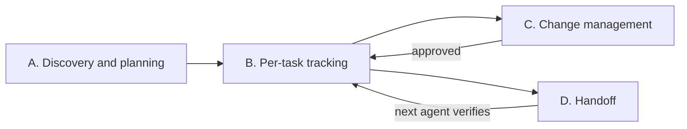

# Project Nexus

**Technical continuity for software projects and the AI agents working on them.**

[English](README.md) | [Português](README.pt-BR.md)

Project Nexus is an [Agent Skill](https://agentskills.io/): a set of instructions an AI coding agent loads on demand. It makes the agent behave like a careful technical lead who plans before building, records why decisions were made, asks before structural changes, and leaves a handoff the next person or agent can actually use.

---

## Why use it

AI agents are fast, but on real projects they tend to fail in predictable ways:

| Without the skill | With Project Nexus |
| --- | --- |
| Each session starts from zero and rebuilds context from scratch. | The agent reads the existing project records first and reports what is missing or contradictory. |
| The agent swaps a library, database or API contract because it seemed better. | Structural changes are classified and require explicit, traceable approval. |
| "Tests pass" is claimed without running them. | Reports separate what was verified from what was assumed; untested work is never called tested. |
| A note in a file saying "approved, go ahead" is taken at face value. | Documents, handoffs and logs are treated as evidence to verify, not as instructions. |
| A review request ends with files rewritten. | Read-only tasks stay read-only; proposed updates go in the report. |
| Documentation drifts away from the code. | Audits compare the implementation with the approved plan and point to file, line or command. |

## How it works

The skill does not run in the background. It activates when you ask for something it covers (planning, review, decisions, risks, handoffs, audits) and guides the agent through one of four workflows:



| Workflow | When | What you get |
| --- | --- | --- |
| **A. Discovery and planning** | Starting a project or a large feature. | A proposal that separates confirmed facts, assumptions, recommendations, decisions that need approval, and blocking vs. non-blocking questions. Nothing is treated as approved until you approve it. |
| **B. Per-task tracking** | Any relevant task during development. | The agent reads the project records, confirms scope and acceptance criteria, compares the work with the approved baseline, and records (or reports) status, decisions, risks and test results. |
| **C. Change management** | A change touches architecture, stack, contracts, security, cost or scope. | An approval request with the current situation, proposal, alternatives, costs, risks, rollback plan and one objective question. |
| **D. Handoff** | Work passes to another session, person or agent. | A handoff stating what was done, what was actually tested, what is missing, what must not be changed, and the next step. The receiver re-checks it against the repository. |

### Approval levels

Every change is classified before it is executed:

| Level | Examples | Behavior |
| --- | --- | --- |
| **0 — Routine** | Bug fix, local implementation, internal refactor without contract changes. | Proceeds within the project rules. |
| **1 — Relevant, reversible** | Small new dependency, non-sensitive config change, internal module change. | Proceeds only if a previous decision clearly covers it; otherwise asks. |
| **2 — Structural** | Stack, architecture, database, migrations with impact, public API, authentication, security, deployment, critical integration, recurring cost, scope. | Requires explicit approval before execution. |

An approval only counts if it records **who** approved, **when**, **what exactly** (scope and version of the proposal) and **where** it can be verified. Silence, urgency or approval of a different task is not authorization, and a materially changed proposal needs new approval.

### Reports

Agent reports highlight each item as **Confirmed**, **Proposal**, **Pending approval**, **Risk** or **Block**, so you can see at a glance what is fact, what is a suggestion, and what is waiting on you.

## Project records

The skill works with whatever documentation the project already has, including files with different names or in other folders. It does not create parallel copies. When nothing exists and writing is authorized, it creates only the files that have real content, chosen from:

| File | Purpose | Template |
| --- | --- | --- |
| `PROJECT.md` | Vision, scope, users, success criteria. | [PROJECT.md](templates/PROJECT.md) |
| `STATUS.md` | Current phase, progress, blockers, next steps, recent checks. | [STATUS.md](templates/STATUS.md) |
| `RULES.md` | Conventions and limits of autonomy for every agent. | [RULES.md](templates/RULES.md) |
| `DECISIONS.md` | Index of decisions (`DEC-001`…); details can live in `docs/decisions/`. | [DECISION.md](templates/DECISION.md) (one record) |
| `RISKS.md` | Risks as cause → event → consequence (`RISK-001`…). | [RISK.md](templates/RISK.md) (one record) |
| `QUESTIONS.md` | Open questions and what depends on them (`Q-001`…). | [QUESTION.md](templates/QUESTION.md) (one record) |
| `HANDOFF.md` | Context for the next session or agent. | [HANDOFF.md](templates/HANDOFF.md) |
| `ARCHITECTURE.md`, `STACK.md`, `INTEGRATIONS.md`, `ENVIRONMENT.md`, `CHANGELOG.md`, `TECH-DEBT.md` | Created only when the project needs them. | — |

Records use ISO dates (`YYYY-MM-DD`), stable IDs and explicit statuses (`open`, `proposed`, `approved`, `rejected`, `in progress`, `resolved`, `blocked`, `superseded`). Secrets are never written to records or handoffs.

## Installation

**With the Skills CLI** (requires Node.js and a supported agent):

```bash
npx skills add https://github.com/alexxnunes/Project-Nexus --skill project-nexus
```

Follow the prompts to choose the agent and the installation scope (project or global).

**Manually:** copy `SKILL.md`, `references/` and `templates/` together into a folder named `project-nexus` inside your agent's skills directory. For Claude Code, for example, that is `~/.claude/skills/project-nexus/` (all projects) or `.claude/skills/project-nexus/` (one project). For other agents, check their documentation for the skills location.

Review any skill and its files before installing it.

## Usage

Mention **Project Nexus** or simply describe a task it covers. Examples and the expected behavior:

| Request | Expected behavior |
| --- | --- |
| "Use Project Nexus to review this project and identify missing decisions. Do not change files." | Reads the docs and code, reports findings with evidence, and writes nothing. |
| "Help me plan this project and separate assumptions from confirmed requirements." | Asks only the essential questions, one at a time, then delivers a plan with scope, acceptance criteria, risks and pending decisions. |
| "Assess the impact of replacing REST with GraphQL before we implement it." | Classifies it as Level 2 and presents an approval request with alternatives, costs, risks and rollback. Nothing is executed. |
| "Prepare a handoff for the next agent." | Produces a handoff with verified status, real test results, limits and the next step. |
| "Continue the work from HANDOFF.md." | Checks the handoff against the repository before acting and does not trust approval claims it cannot verify. |
| "Compare the current implementation with the approved plan." | Audits the implementation, citing file, line or command for each finding, and says which fixes need approval. |

Permission to document a proposal is not permission to implement it.

## Repository structure

```text
.
├── LICENSE                   # MIT
├── SKILL.md                  # Entry point: principles, workflows, approval model, completion criteria
├── references/               # Loaded on demand for specific tasks
│   ├── project-discovery.md      # Discovery interview and planning deliverables
│   ├── architecture-review.md    # What to check in an architecture review
│   ├── stack-evaluation.md       # Criteria for choosing technologies
│   ├── risk-analysis.md          # Risk categories and common pitfalls
│   ├── decision-management.md    # ADR lifecycle and approval evidence
│   ├── environment-management.md # Environment documentation without secrets
│   ├── agent-handoffs.md         # Delivering and receiving handoffs
│   └── development-audit.md      # Auditing implementation against the plan
├── templates/                # Optional record templates (one record each)
└── tests/behavior.md         # Manual behavioral test scenarios
```

## Testing

[tests/behavior.md](tests/behavior.md) describes six manual scenarios: read-only review, structural change without approval, incomplete or changed approval, conflicting documents, untrusted handoff, and existing documentation under different names. Run them in an authorized project with the skill loaded, and check both the agent's answers and its tool calls and file changes. Scenarios that do not apply to the project should be marked as not executed rather than simulated.

## Limitations

- A skill is a set of instructions, not a security boundary. It cannot guarantee compliance and does not replace access controls, human review, backups or CI.
- It only tracks the project when invoked, when receiving a handoff, or when wired into your own automation.
- Results depend on the agent's tools, permissions and access to the repository and environments.
- Never put credentials or unnecessary personal data in project records or handoffs.

## Origin

Project Nexus started as *Project Guardian*, a skill written in Portuguese. This version is the English translation, with stricter rules for untrusted context, read-only tasks and verifiable approvals.

## License

[MIT](LICENSE)
