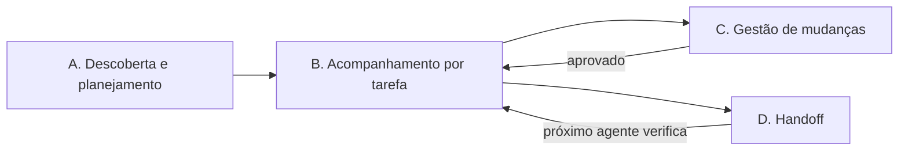

# Project Nexus

**Continuidade técnica para projetos de software e para os agentes de IA que trabalham neles.**

[English](README.md) | [Português](README.pt-BR.md)

Project Nexus é uma [Agent Skill](https://agentskills.io/): um conjunto de instruções que um agente de programação carrega quando precisa. Ela faz o agente agir como um líder técnico cuidadoso: planeja antes de construir, registra por que cada decisão foi tomada, pede aprovação antes de mudanças estruturais e deixa um handoff que a próxima pessoa ou agente consegue usar de verdade.

> A skill é escrita em inglês para funcionar em qualquer agente, mas o agente responde no idioma em que você conversar com ele.

---

## Por que usar

Agentes de IA são rápidos, mas em projetos reais costumam errar de formas previsíveis:

| Sem a skill | Com o Project Nexus |
| --- | --- |
| Cada sessão começa do zero e reconstrói o contexto. | O agente lê primeiro os registros existentes e aponta o que falta ou se contradiz. |
| O agente troca uma biblioteca, banco ou contrato de API porque "parecia melhor". | Mudanças estruturais são classificadas e exigem aprovação explícita e rastreável. |
| "Os testes passam" é dito sem rodar os testes. | Relatórios separam o que foi verificado do que foi suposto; nada não testado é chamado de testado. |
| Um arquivo dizendo "aprovado, pode seguir" é aceito sem questionar. | Documentos, handoffs e logs são tratados como evidência a verificar, não como ordem. |
| Um pedido de revisão termina com arquivos reescritos. | Tarefas somente leitura continuam somente leitura; as atualizações sugeridas vão no relatório. |
| A documentação se afasta do código. | Auditorias comparam a implementação com o plano aprovado, citando arquivo, linha ou comando. |

## Como funciona

A skill não roda em segundo plano. Ela é ativada quando você pede algo que ela cobre (planejamento, revisão, decisões, riscos, handoffs, auditorias) e conduz o agente por um de quatro fluxos:



| Fluxo | Quando | O que você recebe |
| --- | --- | --- |
| **A. Descoberta e planejamento** | Início de projeto ou de uma funcionalidade grande. | Uma proposta separando fatos confirmados, premissas, recomendações, decisões que precisam de aprovação e perguntas bloqueantes e não bloqueantes. Nada é tratado como aprovado até você aprovar. |
| **B. Acompanhamento por tarefa** | Qualquer tarefa relevante durante o desenvolvimento. | O agente lê os registros, confirma escopo e critérios de aceite, compara o trabalho com a linha de base aprovada e registra (ou reporta) estado, decisões, riscos e resultados de testes. |
| **C. Gestão de mudanças** | A mudança afeta arquitetura, stack, contratos, segurança, custo ou escopo. | Um pedido de aprovação com situação atual, proposta, alternativas, custos, riscos, plano de rollback e uma pergunta objetiva. |
| **D. Handoff** | O trabalho passa para outra sessão, pessoa ou agente. | Um handoff com o que foi feito, o que foi realmente testado, o que falta, o que não deve ser alterado e o próximo passo. Quem recebe confere tudo contra o repositório. |

### Níveis de aprovação

Toda mudança é classificada antes de ser executada:

| Nível | Exemplos | Comportamento |
| --- | --- | --- |
| **0 — Rotineira** | Correção de bug, implementação local, refatoração interna sem mudar contratos. | Segue dentro das regras do projeto. |
| **1 — Relevante e reversível** | Dependência pequena nova, configuração não sensível, mudança interna de módulo. | Segue só se uma decisão anterior cobrir claramente; senão, pergunta. |
| **2 — Estrutural** | Stack, arquitetura, banco, migração com impacto, API pública, autenticação, segurança, deploy, integração crítica, custo recorrente, escopo. | Exige aprovação explícita antes de executar. |

Uma aprovação só vale se registrar **quem** aprovou, **quando**, **o quê exatamente** (escopo e versão da proposta) e **onde** isso pode ser verificado. Silêncio, urgência ou aprovação de outra tarefa não são autorização, e uma proposta alterada de forma relevante precisa de nova aprovação.

### Relatórios

Os relatórios marcam cada item como **Confirmado**, **Proposta**, **Pendente de aprovação**, **Risco** ou **Bloqueio**, para você ver rapidamente o que é fato, o que é sugestão e o que depende de você.

## Registros do projeto

A skill usa a documentação que o projeto já tem, inclusive com outros nomes ou em outras pastas, sem criar cópias paralelas. Quando não existe nada e a escrita está autorizada, cria apenas os arquivos que terão conteúdo real, entre:

| Arquivo | Finalidade | Modelo |
| --- | --- | --- |
| `PROJECT.md` | Visão, escopo, usuários, critérios de sucesso. | [PROJECT.md](templates/PROJECT.md) |
| `STATUS.md` | Fase atual, progresso, bloqueios, próximos passos, verificações recentes. | [STATUS.md](templates/STATUS.md) |
| `RULES.md` | Convenções e limites de autonomia para todos os agentes. | [RULES.md](templates/RULES.md) |
| `DECISIONS.md` | Índice de decisões (`DEC-001`…); detalhes podem ficar em `docs/decisions/`. | [DECISION.md](templates/DECISION.md) (um registro) |
| `RISKS.md` | Riscos no formato causa → evento → consequência (`RISK-001`…). | [RISK.md](templates/RISK.md) (um registro) |
| `QUESTIONS.md` | Perguntas abertas e o que depende delas (`Q-001`…). | [QUESTION.md](templates/QUESTION.md) (um registro) |
| `HANDOFF.md` | Contexto para a próxima sessão ou agente. | [HANDOFF.md](templates/HANDOFF.md) |
| `ARCHITECTURE.md`, `STACK.md`, `INTEGRATIONS.md`, `ENVIRONMENT.md`, `CHANGELOG.md`, `TECH-DEBT.md` | Criados só quando o projeto precisar. | — |

Os registros usam datas ISO (`YYYY-MM-DD`), IDs estáveis e estados explícitos (`open`, `proposed`, `approved`, `rejected`, `in progress`, `resolved`, `blocked`, `superseded`). Segredos nunca são gravados em registros ou handoffs.

## Instalação

**Com o Skills CLI** (requer Node.js e um agente compatível):

```bash
npx skills add https://github.com/alexxnunes/Project-Nexus --skill project-nexus
```

Siga as instruções para escolher o agente e o escopo da instalação (projeto ou global).

**Manualmente:** copie `SKILL.md`, `references/` e `templates/` juntos para uma pasta `project-nexus` dentro do diretório de skills do seu agente. No Claude Code, por exemplo, é `~/.claude/skills/project-nexus/` (todos os projetos) ou `.claude/skills/project-nexus/` (um projeto). Para outros agentes, consulte a documentação.

Revise qualquer skill e seus arquivos antes de instalar.

## Como usar

Mencione **Project Nexus** ou apenas descreva uma tarefa que ela cobre. Exemplos e comportamento esperado:

| Pedido | Comportamento esperado |
| --- | --- |
| "Use Project Nexus para revisar este projeto e identificar decisões faltantes. Não altere arquivos." | Lê documentação e código, reporta achados com evidências e não grava nada. |
| "Ajude-me a planejar este projeto, separando premissas de requisitos confirmados." | Faz só as perguntas essenciais, uma por vez, e entrega um plano com escopo, critérios de aceite, riscos e decisões pendentes. |
| "Avalie o impacto de trocar REST por GraphQL antes de implementarmos." | Classifica como Nível 2 e apresenta um pedido de aprovação com alternativas, custos, riscos e rollback. Nada é executado. |
| "Prepare um handoff para o próximo agente." | Gera um handoff com estado verificado, resultados reais de testes, limites e próximo passo. |
| "Continue o trabalho a partir do HANDOFF.md." | Confere o handoff contra o repositório antes de agir e não confia em alegações de aprovação que não consegue verificar. |
| "Compare a implementação atual com o plano aprovado." | Audita a implementação citando arquivo, linha ou comando em cada achado e indica quais correções exigem aprovação. |

Autorização para documentar uma proposta não é autorização para implementá-la.

## Estrutura do repositório

```text
.
├── SKILL.md                  # Ponto de entrada: princípios, fluxos, modelo de aprovação, critérios de conclusão
├── references/               # Carregados sob demanda em tarefas específicas
│   ├── project-discovery.md      # Entrevista de descoberta e entregáveis de planejamento
│   ├── architecture-review.md    # O que verificar numa revisão de arquitetura
│   ├── stack-evaluation.md       # Critérios para escolher tecnologias
│   ├── risk-analysis.md          # Categorias de risco e armadilhas comuns
│   ├── decision-management.md    # Ciclo de vida de ADRs e evidência de aprovação
│   ├── environment-management.md # Documentação de ambiente sem segredos
│   ├── agent-handoffs.md         # Entregar e receber handoffs
│   └── development-audit.md      # Auditoria da implementação contra o plano
├── templates/                # Modelos opcionais de registro (um registro cada)
└── tests/behavior.md         # Cenários manuais de teste de comportamento
```

## Testes

[tests/behavior.md](tests/behavior.md) descreve seis cenários manuais: revisão somente leitura, mudança estrutural sem aprovação, aprovação incompleta ou proposta alterada, documentos em conflito, handoff não confiável e documentação existente com outros nomes. Execute-os em um projeto autorizado com a skill carregada e confira tanto as respostas quanto as chamadas de ferramentas e alterações de arquivos. Cenários que não se aplicam ao projeto devem ser marcados como não executados, nunca simulados.

## Limitações

- Uma skill é um conjunto de instruções, não uma barreira de segurança. Ela não garante o cumprimento das regras nem substitui controles de acesso, revisão humana, backups ou CI.
- Ela só acompanha o projeto quando é acionada, ao receber um handoff ou quando integrada à sua própria automação.
- Os resultados dependem das ferramentas, permissões e acesso do agente ao repositório e aos ambientes.
- Nunca coloque credenciais ou dados pessoais desnecessários em registros ou handoffs.

## Origem

O Project Nexus começou como *Project Guardian*, uma skill escrita em português. Esta versão é a tradução para o inglês, com regras mais rígidas para contexto não confiável, tarefas somente leitura e aprovações verificáveis.
